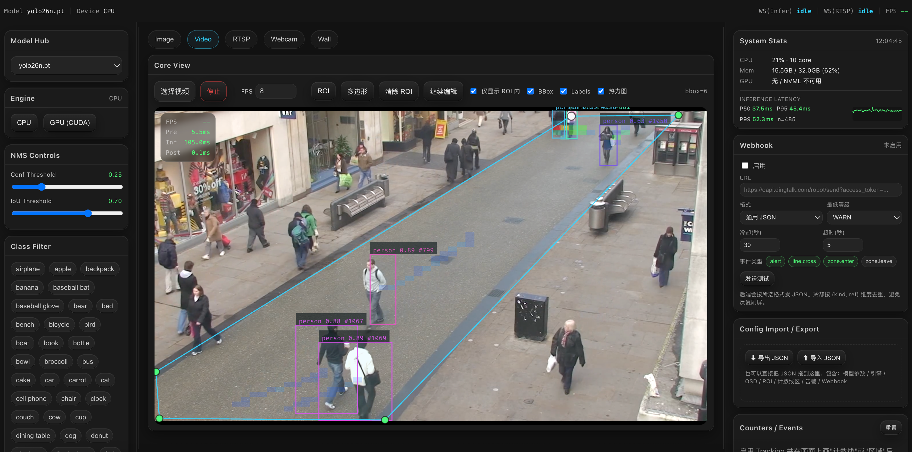
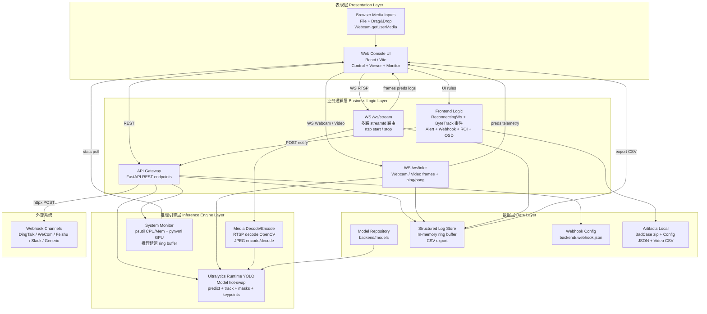

# Ultralytics 工业级前端推理控制台

**中文** | [English](README_EN.md)

<p align="center">
  
  
  
  
  
  
  
</p>

<p align="center">
  <a href="https://github.com/WangQvQ/ultraconsole/blob/main/LICENSE"></a>
  <a href="https://github.com/WangQvQ/ultraconsole/stargazers"></a>
  <a href="https://github.com/WangQvQ/ultraconsole/issues"></a>
  <a href="https://github.com/WangQvQ/ultraconsole/commits"></a>
  
</p>

<p align="center">
  
  
  
  
  
  
  
  
  
  
</p>

面向工业质检 / 安防监控 / 算法调优场景的 **通用目标检测可视化控制台**：模型热切换、参数热更新、Image/Video/Webcam/RTSP/多路监控墙输入、OSD 叠加（含分割/姿态）、ByteTrack 跟踪 + 越线/区域计数事件、空间热力图、GPU/CPU/延迟监控、Webhook 告警出系统、配置一键导入导出、WebSocket 自动重连。

## 页面预览（Screenshot）



## 项目亮点（为什么值得用）

- **工业暗黑风 + Neo-Skeuomorphism**：适合长时间盯盘，关键状态一眼可读。
- **零阻塞实时重绘**：OSD 叠加基于 Canvas，不把高频图形更新塞进 React render；ResizeObserver 只挂一次。
- **后台推理**：REST/Webcam 推理通过 `asyncio.to_thread` 执行，RTSP 使用工作线程；YOLO 调用串行化，多路输入共享推理算力。
- **实时流与录像分别处理**：Webcam 使用最新帧队列和发送背压，RTSP 限制采样率与发送队列；Video 顺序处理设定的采样点，处理较慢时延长分析时间。
- **可观测闭环**：HUD 遥测 + 系统资源面板（CPU/GPU/显存/温度/功耗）+ 推理延迟 P50/P95/P99 + 结构化事件流 + CSV 导出。
- **告警出系统**：内置钉钉 / 企微 / 飞书 / Slack / 通用 JSON 五种 Webhook 格式，按 (kind, ref) 维度冷却去重。
- **多路监控墙**：1×1 / 2×1 / 2×2 / 3×2 / 3×3 网格同屏多路 RTSP，单 WS 多路复用 streamId。
- **目标跟踪 + 事件**：内置 ByteTrack，画"计数线"/"计数区"自动统计 in/out / enter/leave，trackId 稳定颜色 + 轨迹尾迹。
- **实时流重连**：Webcam/RTSP/Wall 支持 WebSocket 指数退避重连与心跳，RTSP 重连后重新拉流；Video 断线会结束本次分析并保留部分报告。
- **配置可迁移**：一键导出 JSON（参数/引擎/OSD/ROI/计数线区/告警/Webhook 全套），到另一台机拖拽即生效。
- **可替换推理内核**：默认 `pip install ultralytics`，支持切换到你"魔改版 ultralytics"。
- **中英双语**：界面支持中文/英文一键切换（顶栏 `中/EN` 按钮），默认中文；README 提供中英双语版本。

## 功能一览

### 模型与环境控制

- **Model Hub**：从 `backend/models/` 下拉选择模型（`.pt/.onnx/.engine`），路径白名单校验
- **Engine**：CPU/CUDA 切换；同设备直接 no-op，不同设备只 warmup（不重 load 权重）
- **NMS**：Conf/IoU 滑块实时调整，前端 200ms 防抖回写
- **Class Filter**：多选标签过滤类别
- **Tracking**：勾选启用 ByteTrack（Webcam / RTSP / Wall；Video 分析自动启用），bbox 自动带 `#trackId`

### 输入源

- **Image**：上传或**拖拽**即推理；阈值变化自动重跑（带 pending 队列）
- **Video**：本地视频顺序采样分析（可设 FPS），支持**拖拽**、独立 ByteTrack 跟踪、越线/区域计数、视频时间与分析 CSV 导出。
- **Webcam**：浏览器摄像头实时推理（WS 推帧；toBlob 异步编码 + 背压控制）
- **RTSP**：填地址即连（后端拉流 → JPEG → WS）
- **Wall**：1×1 / 2×1 / 2×2 / 3×2 / 3×3 多路 RTSP 网格，每格独立 OSD + bbox 计数 HUD

### 可视化与效率

- **OSD**：BBox / Labels / Masks（实例分割半透明）/ Keypoints（COCO-17 骨架）/ Trails（轨迹尾迹）
- **稳定颜色**：按 trackId 哈希到 HSL，跨帧颜色一致
- **Telemetry HUD**：FPS / 耗时（Pre/Infer/Post）
- **ROI**：矩形/多边形绘制 +"仅显示 ROI 内目标"（前端显示过滤），支持触屏；计数范围由 Counting Line / Zone 单独定义
- **Counting Line / Zone**：在画面上画线/画区，自动统计跨线/进出区
- **BadCase**：📷 一键打包下载 `zip(frame.jpg + config.json + pred.json)`

### 监控与数据沉淀

- **Event Logger**：滚动结构化日志，CSV 导出 `/api/logs/export.csv`
- **Alert Engine**：类别连续 N 帧触发告警（红色呼吸边框 + 可选蜂鸣）；Video 录像分析不触发此告警
- **Counters / Events**：实时显示线 in/out、区域 当前/累计 数量 + 最近 30 条事件流
- **System Stats**：CPU% / Mem / 多 GPU util/显存/温度/功耗 + 推理延迟 P50/P95/P99 + 60 帧 sparkline
- **Webhook**：钉钉 / 企微 / 飞书 / Slack / 通用 JSON 五种格式；告警 + 计数事件实时推送；按 (kind, ref) 冷却去重，Video 录像事件不派发
- **Config Import / Export**：一键导出全套 JSON 配置；拖拽 JSON 到面板即应用

## Video 录像分析与计数

1. 在 Model Hub 选择模型，切换到 **Video**，选择或拖入浏览器可解码的本地视频。
2. 点击「画计数线」，在画面中点击两个端点；或点击「画计数区」，依次点击至少三个顶点，再点击起点闭合。画好后点击「完成绘制」。
3. 设置采样 FPS（1–30，默认 8），点击「从头分析（含跟踪）」。Video 自动启用 ByteTrack，无需勾选实时流的 Tracking 开关。
4. 在 Counters / Events 查看越线方向、区域当前数量、累计进入次数和事件的视频时间。
5. 完成或停止后，点击「导出分析 CSV」。切换文件或离开 Video 前请先导出，报告仅保存在当前页面内存中。

每次开始都会清空本次统计、从视频起点重新分析，并建立新的跟踪连接。分析期间关闭播放控制；停止后可以预览或拖动进度，再次开始仍会从头统计。修改模型、设备、推理参数或计数规则会停止当前分析，避免混用结果。

分析按 `0、1/FPS、2/FPS…` 的视频时间顺序采样，收到上一帧结果后才发送下一帧。处理速度取决于推理性能；这不是逐原始帧分析，低采样率、检测漏检和跟踪 ID 变化仍可能影响计数。

| 指标 / 报告内容 | 含义 |
|---|---|
| 线 `in / out` | 跟踪框中心穿过所画有限线段的两个方向；方向取决于端点顺序 |
| 区域 `current` | 当前采样帧中位于区域内的跟踪目标数量 |
| 区域 `total` | 累计进入次数，包含首次检测时已在区域内的目标，不是去重人数 |
| 事件时间 | 视频内的时间，例如 `00:02:35.125` |
| CSV 元信息 | 文件名、视频时长、采样 FPS、已处理帧数、最后采样时间、模型、参数和规则快照 |
| CSV 明细 | 计数汇总和全部事件，不受界面保留最近 500 条、显示最近 30 条的限制 |
| CSV 状态 | `completed` / `stopped` / `error`；停止或失败后的结果只覆盖已处理部分 |

录像分析不触发实时 Alert Engine 或 Webhook，避免将历史事件作为当前告警发送。分析 CSV 与 Event Logger 的运行日志 CSV 是两种不同报告。

## 目录结构

```
backend/                    # FastAPI + Ultralytics 推理服务
├── app/
│   ├── main.py             # REST + 两路 WS（/ws/infer, /ws/stream 多路 streamId）
│   ├── config.py          # 环境变量与资源限制
│   ├── security.py        # REST / WS 鉴权与 URL 校验
│   ├── infer_runtime.py    # YOLO 加载/推理/跟踪，masks + keypoints 提取
│   ├── system_stats.py     # CPU/GPU 监控 + 推理延迟 ring buffer
│   ├── webhook.py          # Webhook 配置持久化 + 多格式派发
│   ├── schemas.py          # Pydantic 模型（含 trackId/masks/keypoints/SystemStats）
│   ├── logging_store.py    # 内存 ring buffer + CSV 导出
│   └── state.py            # 全局可变状态（params / engine / logs）
├── models/                 # 权重文件（已 gitignore）
├── tests/                  # 后端回归测试
├── requirements-dev.txt    # pytest / Ruff
└── requirements.txt

frontend/                   # React 19 + Vite + TypeScript + zustand
└── src/
    ├── pages/ConsolePage   # 三栏布局（左控制 / 中视图 / 右监控），可拖拽分隔条
    ├── ui/
    │   ├── control/        # ControlPanel: Model/Engine/NMS/Class/Tracking
    │   ├── viewer/
    │   │   ├── tabs/       # Image/Video/Webcam/Rtsp/Wall
    │   │   └── widgets/    # CanvasOverlay / VideoCanvasOverlay / RoiOverlay /
    │   │                   # EventEditOverlay / TelemetryHUD
    │   ├── monitor/        # SystemStatsCard / WebhookCard / ConfigCard /
    │   │                   # MonitorPanel（Counters/Events/Alert/Logs）
    │   ├── status/         # 顶栏 SystemStatusBar
    │   └── primitives/     # Card / NeoButton
    ├── store/              # zustand 全局 store
    ├── api/                # REST / WS 工具 + contracts.ts 共享类型
    ├── i18n/               # 国际化（中文/英文）
    └── utils/              # draw / events / roi / configIO / reconnectWs /
                            # useEventTracker / useSystemStats /
                            # useWebhookDispatcher / badcase / videoAnalysis / binaryFrame
```

## 快速开始

环境要求：Python 3.10+、Node.js 22.12+、npm。CUDA 推理需要兼容的 NVIDIA 驱动与 PyTorch；仅使用 CPU 时不需要 NVIDIA 环境。

### 1）准备模型文件

把权重文件放到 `backend/models/*.pt`（或 `.engine/.onnx`）

### 2）启动后端（FastAPI）

#### 方式 A：venv

```bash
cd backend
python3 -m venv .venv
source .venv/bin/activate
python -m pip install -r requirements.txt
uvicorn app.main:app --reload --port 8001
```

#### 方式 B：conda

```bash
conda create -n ultralytics-console python=3.10 -y
conda activate ultralytics-console
cd backend
python -m pip install -r requirements.txt
uvicorn app.main:app --reload --port 8001
```

> 请完整安装 `requirements.txt`。无 NVIDIA 驱动时 GPU 指标不可用，CPU 推理仍可运行；`httpx` 是后端启动依赖，不能省略。

### 3）启动前端（React）

另开终端，从仓库根目录执行：

```bash
cd frontend
npm ci
npm run dev
```

默认打开 `http://localhost:5173`，选择模型后开始使用。前端开发服务器把 `/api` 与 `/ws` 代理到 `http://127.0.0.1:8001`。

## 常用配置

| 项 | 默认 | 来源 |
|---|---|---|
| 后端端口 | `8001` | 启动命令 |
| 模型目录 | `backend/models/`（由后端代码位置解析） | 环境变量 `ULTRA_MODELS_DIR` |
| Webhook 持久化 | `backend/.webhook.json`（gitignore） | 环境变量 `ULTRA_WEBHOOK_FILE` |
| 默认设备 | `cpu` | 环境变量 `ULTRA_DEVICE=cuda` |

### 安全与资源限制

配置通过后端进程环境变量读取。若使用文件，在 `backend/` 下复制 `cp .env.example .env`，修改后通过 `uvicorn app.main:app --reload --port 8001 --env-file .env` 显式加载；仅复制文件不会自动生效。

- `ULTRA_API_TOKEN`：设置后保护除健康检查外的 REST API 和全部 WebSocket；前端构建时设置同值的 `VITE_ULTRA_API_TOKEN`
- `ULTRA_CORS_ORIGINS`：允许的前端 Origin，逗号分隔；默认仅本机开发地址
- `ULTRA_MAX_UPLOAD_BYTES` / `ULTRA_MAX_IMAGE_PIXELS`：上传文件与解码后像素上限
- `ULTRA_MAX_RTSP_STREAMS` / `ULTRA_MAX_RTSP_FPS`：并发流数与单流 FPS 上限
- `ULTRA_MAX_WS_BASE64_CHARS`：WebSocket 帧编码长度上限，默认 16 MiB 字符
- `ULTRA_MAX_TRACKER_CONTEXTS`：独立跟踪上下文上限，默认 10；每个上下文会增加模型内存/显存占用
- `ULTRA_ALLOWED_RTSP_HOSTS`：可选的 RTSP 主机白名单
- `ULTRA_ALLOW_PRIVATE_WEBHOOKS`：默认 `false`，防止 Webhook 访问本机、内网和链路本地地址

启用鉴权时，在 `frontend/.env.local` 设置相同的 `VITE_ULTRA_API_TOKEN`，然后重启开发服务器或重新构建。未设置后端 Token 时不校验凭证。REST 客户端可使用 `Authorization: Bearer <token>`；浏览器 WebSocket 通过 `ultra-token.<base64url-token>` 子协议携带凭证。

API Token 会被编译进浏览器端资源，因此它是部署级共享访问凭证，不应复用于其他系统。

## REST / WebSocket API

### REST

| Method | Path | 说明 |
|---|---|---|
| `GET` | `/api/health` | 健康检查 |
| `GET` | `/api/models` | 列出 `models/` 下可用模型 + 当前已加载模型回填 |
| `POST` | `/api/models/select` | 加载模型（`{modelId}`，做路径白名单 + 后缀校验） |
| `POST` | `/api/engine/select` | 切换 CPU/CUDA（`{device}`，同设备 no-op） |
| `GET` `/POST` | `/api/params` | 获取/更新 `{conf, iou, classFilter, track}` |
| `POST` | `/api/infer/image` | 单图推理（`multipart/form-data: file`） |
| `POST` | `/api/infer/frame` | 兼容旧客户端的单帧推理（同 image 入口）；Video 分析使用 `/ws/infer` |
| `GET` | `/api/system/stats` | CPU/GPU/Mem + 推理延迟分位 |
| `GET` `/POST` | `/api/webhook` | 取/存 webhook 配置 |
| `POST` | `/api/webhook/test` | 联通性测试 |
| `POST` | `/api/notify` | 派发告警/事件到 webhook |
| `GET` | `/api/logs/export.csv` | 滚动日志 CSV 导出 |

### WebSocket

- `/ws/infer` — Webcam / Video 推帧通道：客户端发 `{type:'frame', imageJpegBase64, ...}`，服务端回 `{type:'pred'|'log'}`；接受 `{type:'ping'}` → `{type:'pong'}`
- `/ws/stream` — RTSP 多路通道：
  - 客户端发 `{type:'rtsp.start', streamId, url, fps, conf, iou, classFilter, track}`
  - `{type:'rtsp.stop', streamId}` 单路停 / `{type:'rtsp.stopAll'}` 全停
  - 视频帧使用二进制包返回：`大端 uint32 JSON头字节数 + JSON元数据 + JPEG`，预测和日志仍为 JSON
  - 同样支持 `ping/pong`

## 使用"魔改版 ultralytics"的方式

### 方式 1：本地源码可编辑安装

```bash
conda activate ultralytics-console   # 或 source backend/.venv/bin/activate
python -m pip uninstall -y ultralytics
python -m pip install -e ~/work/ultralytics

cd backend
uvicorn app.main:app --reload --port 8001
```

修改源码后无需重新安装，重启 uvicorn 即可生效。

### 方式 2：把依赖指向本地路径

把 `backend/requirements.txt` 里的 `ultralytics` 改成：

```txt
-e /absolute/path/to/ultralytics
```

## Webhook 配置（钉钉示例）

1. 在监控面板 Webhook 卡片：
   - 勾选"启用"
   - URL 粘贴钉钉自定义机器人 webhook（推荐用"自定义关键词"安全模式）
   - 格式选"钉钉"，最低等级 `WARN`，冷却 30 秒
   - 事件类型勾上 `alert`、`line.cross`、`zone.enter`
   - 点"发送测试" → 群里收到 `ℹ️ [INFO] Webhook 测试`
2. 启用 Tracking + 画一条计数线 + 启动 Webcam/RTSP
3. 有目标穿线时群里实时收到：
   ```
   ⚠️ [WARN] 计数线 L1 in
   person#7
   ref: line_a8f1
   - trackId: 7
   - cls: person
   - direction: in
   ts: 2026-05-07 18:42:11
   ```

## 架构图



## FAQ

### 1）为什么 RTSP 用 WS 推 JPEG 帧？

V1 优先"可用与易集成"：前端只需填地址即可出画面；后续如需更省带宽/更低延迟，可升级为 HLS/WebRTC + 单独 WS 下发 preds。

### 2）模型/权重文件会不会被提交到开源仓库？

不会：仓库已在 `.gitignore` 忽略 `backend/models/**/*.pt|onnx|engine` 等大文件类型，以及 `backend/.webhook.json`（含外部 URL 不入仓库）。

### 3）多路 Wall 同屏跟踪时 trackId 会不会跨路串号？

当前实现按跟踪 key 分配独立模型实例：Webcam/Video 按连接隔离，RTSP/Wall 按 `streamId` 隔离。同一监控墙的各路目标不会共用跟踪状态，但不同路的数字 ID 可以相同，不能当作跨摄像头身份。不同客户端连接同一后端时，应避免复用相同 RTSP `streamId`。独立实例会增加内存/显存占用。

### 4）GPU 监控面板显示"NVML 不可用"？

说明 `nvidia-ml-py` 未安装或当前机器无 NVIDIA 驱动。CPU/Mem 仍可显示（依赖 `psutil`）；不影响推理。

### 5）Webhook 派发被钉钉拒绝？

钉钉自定义机器人若开了"加签安全"或"IP 白名单"会失败。建议先用"自定义关键词"模式（最简单），把关键词设成"告警"/"UltraConsole" 等。

### 6）WebSocket 自动重连会清空 ByteTrack 跟踪状态吗？

会重新建立跟踪状态。Webcam 断开后释放连接的跟踪上下文，RTSP 停止后也会释放对应上下文；重连恢复视频流时，不保证 ID 连续。Video 不自动重连续算，断线后可导出部分报告，重新开始会从头分析。

### 7）配置导出的 JSON 里有 webhook URL 明文吗？

有。导出文件含敏感 URL，UI 上没遮挡。如需更严格可在导出前手工删除 webhook 字段，或后续加"导出时屏蔽 webhook"开关。

## 开发与验证

以下命令从仓库根目录执行，并使用已激活的后端虚拟环境：

```bash
python -m pip install -r backend/requirements-dev.txt
python -m pytest
ruff check backend/app backend/tests
npm --prefix frontend ci
npm --prefix frontend test
npm --prefix frontend run lint
npm --prefix frontend run build
```

GitHub Actions 在 push 和 pull request 时运行上述前后端测试、静态检查及前端构建。测试覆盖参数校验、访问控制、跟踪隔离、最新帧队列、二进制帧、Video 计数和报告等；模型精度、真实视频解码与 GPU/摄像头兼容性仍需使用实际设备和样本验证。

## 贡献指南

- 欢迎提 Issue/PR：
  - Bug：请带复现步骤、日志与输入源信息（Image/Video/Webcam/RTSP/Wall）
  - Feature：建议先开 Issue 讨论接口与交互
- 路线图（已落地以 ✅ 标）：
  - ✅ 多路监控墙、ByteTrack + 事件、分割/姿态、GPU/CPU HUD、延迟分位、Webhook、WS 重连、拖拽上传、配置导入导出
  - ✅ 中英双语 i18n、空间热力图、Video 顺序分析与计数报告、可选 Token 鉴权、安全与资源限制、前后端测试与 CI
  - ⏳ 模型 A/B 对比、SQLite 持久化、截图导出、插件系统
